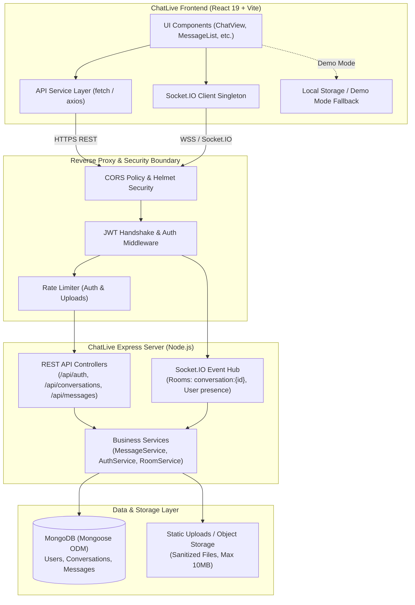

# ChatLive — Phase 2 Backend Specification & Implementation Roadmap

> **Document Type:** Technical Architecture Specification & Implementation Plan  
> **Status:** Active Roadmap for Phase 2  
> **Target Version:** ChatLive v2.0.0-fullstack  
> **Repository Baseline:** Phase 1 Frontend MVP (`v1.0.0-phase1-checkpoint`)  

---

## 1. Executive Summary & Repository Status Audit

### 1.1 Actual Repository Verification
A rigorous audit of the repository was conducted to verify current capabilities and separate completed work from planned tasks:

| Scope Area | Current Repository State | Verification Evidence |
| :--- | :--- | :--- |
| **Frontend UI/UX** | **Complete & Verified (Phase 1)** | React 19 + Vite 8 + Tailwind CSS 4; retro pixel aesthetic (*Dogica* fonts), responsive layout, animations via Motion. |
| **Demo Authentication** | **Complete (Phase 1 Simulation)** | Quick Fill demo login, protected client routes (`/chat`, `/profile`), `localStorage` persistence, zero server interaction. |
| **Chat Interactions** | **Complete (Phase 1 Simulation)** | Channels & DMs, message replies, emoji reactions, inline editing, message deletion, attachment previews (max 5, 10MB, SVG blocked), mock simulated delivery receipts (`sent` -> `delivered` -> `read`). |
| **Automated Checks** | **100% Green** | `npm test` (3/3 passing), `npm run lint` (0 ESLint errors), `npm run build` (production bundle built in ~600ms). |
| **Git Baseline** | **Clean & Tagged** | Branch `master` synced with origin; recoverable checkpoint tag `v1.0.0-phase1-checkpoint`. |
| **Backend & Server** | **Planned (Phase 2 Scope)** | No server runtime, database connection, or WebSocket server currently exists in the workspace. |

---

## 2. High-Level System Architecture

ChatLive Phase 2 transitions the application from a browser-isolated prototype into a full-stack real-time collaboration platform.

### 2.1 System Topology Diagram



---

## 3. Node.js & Express Server Architecture

### 3.1 Recommended Backend Project Layout
The backend will reside within a dedicated `server/` directory inside the repository to ensure clean isolation of dependencies, build tools, and secrets from frontend client code:

```
server/
├── src/
│   ├── config/
│   │   ├── db.js                # Mongoose connection & retry logic
│   │   ├── env.js               # Validated process.env schema
│   │   └── cors.js              # Whitelisted origins & credentials
│   ├── constants/
│   │   ├── events.js            # Socket event string constants
│   │   └── httpStatus.js        # Named HTTP status codes
│   ├── controllers/
│   │   ├── authController.js    # Register, login, me
│   │   ├── convController.js    # List, create, get conversation
│   │   ├── messageController.js # Paginated messages, send, edit, delete, search
│   │   ├── userController.js    # Profile update, user lookup
│   │   └── uploadController.js  # Multipart file handler
│   ├── middleware/
│   │   ├── authMiddleware.js    # JWT bearer verification (req.user)
│   │   ├── roomAuth.js          # Conversation membership check
│   │   ├── validate.js          # Request payload validation schema
│   │   └── errorHandler.js      # Centralized error handler
│   ├── models/
│   │   ├── User.js              # User schema & password hashing hooks
│   │   ├── Conversation.js      # Conversation schema & compound indexes
│   │   └── Message.js           # Message schema, attachments & reactions
│   ├── routes/
│   │   ├── authRoutes.js
│   │   ├── convRoutes.js
│   │   ├── messageRoutes.js
│   │   ├── userRoutes.js
│   │   └── uploadRoutes.js
│   ├── sockets/
│   │   ├── socketServer.js      # Socket.IO initialization
│   │   ├── handshakeAuth.js     # JWT handshake middleware
│   │   ├── chatHandlers.js      # message:send, typing, read receipts
│   │   └── presenceManager.js   # Online/away tracking & room disconnections
│   ├── utils/
│   │   ├── apiResponse.js       # Standardized response envelopes
│   │   ├── cursorPagination.js  # Cursor encoding/decoding
│   │   └── logger.js            # Structured logger
│   └── app.js                   # Express app configuration & HTTP server bootstrap
├── tests/
│   ├── auth.test.js
│   ├── conversations.test.js
│   ├── messages.test.js
│   └── sockets.test.js
├── .env.example
├── package.json
└── README.md
```

### 3.2 Centralized Error Handling & Response Envelope
All REST API endpoints will return responses adhering to a strict, uniform JSON schema:

#### Success Envelope (`200 OK`, `201 Created`)
```json
{
  "success": true,
  "data": { ... },
  "meta": {
    "cursor": "653b1b9e28d9c1234567890a",
    "hasMore": true,
    "total": 42
  }
}
```

#### Error Envelope (`400`, `401`, `403`, `404`, `429`, `500`)
```json
{
  "success": false,
  "error": {
    "code": "CONVERSATION_ACCESS_DENIED",
    "message": "You are not an authorized member of this conversation.",
    "details": []
  }
}
```

---

## 4. MongoDB & Mongoose Data Model Specifications

### 4.1 `User` Model
Represents user identities, authentication hashes, and collaboration metadata.

```javascript
import mongoose from "mongoose";

const userSchema = new mongoose.Schema(
  {
    name: {
      type: String,
      required: [true, "Name is required"],
      trim: true,
      minlength: [2, "Name must be at least 2 characters"],
      maxlength: [50, "Name cannot exceed 50 characters"],
    },
    email: {
      type: String,
      required: [true, "Email is required"],
      unique: true,
      trim: true,
      lowercase: true,
      match: [/^\S+@\S+\.\S+$/, "Please provide a valid email address"],
    },
    passwordHash: {
      type: String,
      required: [true, "Password hash is required"],
      select: false, // Omitted from query results by default
    },
    avatarUrl: {
      type: String,
      default: "male", // Enum "male" | "female" or valid image URL
    },
    status: {
      type: String,
      enum: ["active", "away", "dnd"],
      default: "active",
    },
    lastSeenAt: {
      type: Date,
      default: Date.now,
    },
    title: {
      type: String,
      trim: true,
      maxlength: [60, "Title cannot exceed 60 characters"],
      default: "",
    },
    bio: {
      type: String,
      trim: true,
      maxlength: [240, "Bio cannot exceed 240 characters"],
      default: "",
    },
    timezone: {
      type: String,
      default: "UTC",
    },
  },
  { timestamps: true }
);

// Indexes
userSchema.index({ email: 1 }, { unique: true });
userSchema.index({ name: "text" });
```

### 4.2 `Conversation` Model
Represents channels and 1-on-1 direct message conversations.

```javascript
import mongoose from "mongoose";

const conversationSchema = new mongoose.Schema(
  {
    type: {
      type: String,
      enum: ["channel", "dm"],
      required: [true, "Conversation type is required"],
    },
    name: {
      type: String,
      trim: true,
      required: function () {
        return this.type === "channel";
      },
      maxlength: [50, "Channel name cannot exceed 50 characters"],
    },
    memberIds: [
      {
        type: mongoose.Schema.Types.ObjectId,
        ref: "User",
        required: true,
      },
    ],
    adminIds: [
      {
        type: mongoose.Schema.Types.ObjectId,
        ref: "User",
      },
    ],
    lastMessageAt: {
      type: Date,
      default: Date.now,
    },
    // Denormalized preview for high-speed sidebar rendering
    lastMessagePreview: {
      body: { type: String, default: "" },
      senderName: { type: String, default: "" },
      at: { type: Date, default: Date.now },
    },
  },
  { timestamps: true }
);

// Indexes
// High performance sidebar sort by member and latest message
conversationSchema.index({ memberIds: 1, lastMessageAt: -1 });

// Ensure uniqueness for DM pairs (sorted memberIds prevents duplicate inverse DMs)
conversationSchema.index(
  { type: 1, memberIds: 1 },
  { unique: true, partialFilterExpression: { type: "dm" } }
);
```

### 4.3 `Message` Model
Represents threaded, reactive messages with attachments, edit history, and reactions.

```javascript
import mongoose from "mongoose";

const attachmentSubSchema = new mongoose.Schema(
  {
    name: { type: String, required: true },
    size: { type: Number, required: true },
    type: { type: String, required: true },
    url: { type: String, required: true },
  },
  { _id: false }
);

const reactionSubSchema = new mongoose.Schema(
  {
    emoji: { type: String, required: true },
    users: [{ type: mongoose.Schema.Types.ObjectId, ref: "User" }],
  },
  { _id: false }
);

const readReceiptSubSchema = new mongoose.Schema(
  {
    user: { type: mongoose.Schema.Types.ObjectId, ref: "User", required: true },
    readAt: { type: Date, default: Date.now },
  },
  { _id: false }
);

const messageSchema = new mongoose.Schema(
  {
    conversationId: {
      type: mongoose.Schema.Types.ObjectId,
      ref: "Conversation",
      required: true,
      index: true,
    },
    senderId: {
      type: mongoose.Schema.Types.ObjectId,
      ref: "User",
      required: true,
      index: true,
    },
    body: {
      type: String,
      trim: true,
      default: "",
      maxlength: [4000, "Message cannot exceed 4000 characters"],
    },
    attachments: [attachmentSubSchema],
    replyToId: {
      type: mongoose.Schema.Types.ObjectId,
      ref: "Message",
      default: null,
    },
    reactions: [reactionSubSchema],
    readBy: [readReceiptSubSchema],
    editedAt: {
      type: Date,
      default: null,
    },
    deletedAt: {
      type: Date,
      default: null, // Soft deletion
    },
    clientTempId: {
      type: String,
      index: true, // Idempotency key for deduplication
    },
  },
  { timestamps: true }
);

// Compound Indexes
// Primary index for cursor-based backward pagination:
messageSchema.index({ conversationId: 1, createdAt: -1 });

// Compound index for active message search excluding deleted messages:
messageSchema.index({ conversationId: 1, deletedAt: 1, createdAt: -1 });

// Full-text search index on message body:
messageSchema.index({ body: "text" });
```

---

## 5. Authentication, Authorization & Security Architecture

### 5.1 Password Hashing & Verification
- Hashing will use `bcrypt` with a minimum cost factor of `12` rounds.
- Plaintext passwords will never be logged, printed, or saved in any database record.
- Registration will enforce password complexity (minimum 8 characters, at least one number or symbol).

### 5.2 Server-Issued JWT Specification
- **Algorithm:** HMAC-SHA256 (`HS256`).
- **Secret Key:** `process.env.JWT_SECRET` (validated at startup to be $\ge 32$ characters).
- **Expiration:** Configurable via `JWT_EXPIRES_IN` (e.g. `1d` for initial backend).
- **Token Claims:**
  ```json
  {
    "sub": "653b1b9e28d9c1234567890a",
    "email": "user@example.com",
    "name": "Alex Mercer",
    "iat": 1729864800,
    "exp": 1729951200
  }
  ```

### 5.3 Authorization Rules & Guards
1. **Authentication Guard (`authenticate`):**  
   Validates standard `Authorization: Bearer <token>` header. Populates `req.user`. Returns `401 Unauthorized` for expired or tampered tokens.
2. **Conversation Access Guard (`requireConversationMember`):**  
   Verifies that `req.user.id` exists in the target conversation's `memberIds` array. Returns `403 Forbidden` if unauthorized.
3. **Message Author Guard (`requireMessageAuthor`):**  
   Ensures that only the original `senderId` can edit a message or delete it (unless the user is an admin of the channel, in which case channel moderation deletion is allowed).

---

## 6. REST API Endpoints Specification

### 6.1 Authentication (`/api/auth`)
| Method | Endpoint | Auth | Description | Status Codes |
| :--- | :--- | :--- | :--- | :--- |
| `POST` | `/api/auth/register` | None | Register new user account with name, email, password | `201`, `400`, `409` |
| `POST` | `/api/auth/login` | None | Verify credentials and issue JWT | `200`, `400`, `401` |
| `GET` | `/api/auth/me` | Bearer | Retrieve profile of authenticated user | `200`, `401` |

### 6.2 Users & Profiles (`/api/users`)
| Method | Endpoint | Auth | Description | Status Codes |
| :--- | :--- | :--- | :--- | :--- |
| `GET` | `/api/users` | Bearer | Search users by name/email for starting new DMs | `200`, `401` |
| `PATCH` | `/api/users/profile` | Bearer | Update display name, title, bio, timezone, avatar | `200`, `400`, `401` |
| `PATCH` | `/api/users/status` | Bearer | Update status (`active`, `away`, `dnd`) | `200`, `400`, `401` |

### 6.3 Conversations (`/api/conversations`)
| Method | Endpoint | Auth | Description | Status Codes |
| :--- | :--- | :--- | :--- | :--- |
| `GET` | `/api/conversations` | Bearer | List all conversations the user is a member of | `200`, `401` |
| `POST` | `/api/conversations` | Bearer | Create a new channel or initiate a direct message | `201`, `400`, `401` |
| `GET` | `/api/conversations/:id`| Bearer | Fetch details, members, and metadata for a conversation| `200`, `403`, `404` |

### 6.4 Messages & Search (`/api/conversations/:id/messages`)
| Method | Endpoint | Auth | Description | Status Codes |
| :--- | :--- | :--- | :--- | :--- |
| `GET` | `/api/conversations/:id/messages` | Bearer | Cursor-paginated message history (`?cursor=&limit=30`) | `200`, `403`, `404` |
| `POST` | `/api/conversations/:id/messages` | Bearer | Send message via REST (fallback or standard path) | `201`, `400`, `403` |
| `PATCH` | `/api/messages/:id` | Bearer | Edit message body (author only) | `200`, `400`, `403`, `404` |
| `DELETE`| `/api/messages/:id` | Bearer | Soft-delete message (author or channel admin) | `200`, `403`, `404` |
| `GET` | `/api/conversations/:id/messages/search`| Bearer | Full-text query (`?q=term`) within conversation | `200`, `403`, `404` |

### 6.5 File Uploads (`/api/upload`)
| Method | Endpoint | Auth | Description | Status Codes |
| :--- | :--- | :--- | :--- | :--- |
| `POST` | `/api/upload` | Bearer | Upload single or multi-part attachment (max 10MB) | `201`, `400`, `413`, `415` |

#### Attachment Security Restrictions:
- Allowed MIME Types: `image/png`, `image/jpeg`, `image/webp`, `image/gif`, `application/pdf`, `text/plain`.
- Prohibited MIME Types: `image/svg+xml` (strictly blocked to eliminate stored XSS execution in browsers), executable binaries, shell scripts, and HTML files.

---

## 7. Cursor-Based Pagination Architecture

### 7.1 Why Offset Pagination Fails in Real-Time Chat
Standard `skip` and `limit` pagination produces subtle and frustrating user bugs in active chat rooms:
- When a client is viewing page 1 and new messages are inserted into the database, an offset query for page 2 (`skip: 30`) skips newly shifted records or delivers duplicates.
- Large `skip` queries force the database to scan and discard thousands of index entries.

### 7.2 Cursor Mechanics
ChatLive Phase 2 implements **Timestamp/ID Cursor Pagination**:
- The client requests the initial batch: `GET /api/conversations/:id/messages?limit=30`.
- The server queries `Message.find({ conversationId, deletedAt: null }).sort({ createdAt: -1 }).limit(30)`.
- The response returns the 30 newest messages plus a `meta.nextCursor` set to the `_id` (or ISO timestamp) of the oldest message in that batch.
- When the user scrolls up, the client requests the next batch:
  ```http
  GET /api/conversations/:id/messages?cursor=653b2100a98b76543210fedc&limit=30
  ```
- The server executes:
  ```javascript
  const query = {
    conversationId,
    deletedAt: null,
    _id: { $lt: cursorId } // Or { createdAt: { $lt: cursorDate } }
  };
  return Message.find(query).sort({ createdAt: -1 }).limit(limit);
  ```
- This guarantees $O(\log N)$ indexed lookups without duplicate records or missed messages.

---

## 8. Socket.IO Real-Time Architecture

### 8.1 Connection Handshake Authentication
Socket.IO connections are authenticated during the initial WebSocket handshake before any connection event is accepted:

```javascript
// Server: src/sockets/handshakeAuth.js
io.use(async (socket, next) => {
  try {
    const token = socket.handshake.auth?.token || socket.handshake.headers?.authorization?.replace("Bearer ", "");
    if (!token) {
      return next(new Error("AUTHENTICATION_REQUIRED"));
    }
    const decoded = jwt.verify(token, process.env.JWT_SECRET);
    const user = await User.findById(decoded.sub).select("-passwordHash");
    if (!user) {
      return next(new Error("USER_NOT_FOUND"));
    }
    socket.user = user;
    next();
  } catch (err) {
    return next(new Error("INVALID_TOKEN"));
  }
});
```

### 8.2 Room Authorization & Scoping
- **Room Naming:** `conversation:${conversationId}`
- **Joining a Room:**
  When a client emits `conversation:join` with `{ conversationId }`, the server executes a membership authorization check:
  ```javascript
  socket.on("conversation:join", async ({ conversationId }, ack) => {
    const isMember = await Conversation.exists({
      _id: conversationId,
      memberIds: socket.user._id,
    });
    if (!isMember) {
      return ack?.({ error: "FORBIDDEN_CONVERSATION" });
    }
    socket.join(`conversation:${conversationId}`);
    ack?.({ status: "joined", conversationId });
  });
  ```
- Unauthenticated or unauthorized room joins are blocked at the socket boundary.

### 8.3 Real-Time Event Matrix

| Event Name | Direction | Payload | Description |
| :--- | :--- | :--- | :--- |
| `message:send` | Client $\to$ Server | `{ conversationId, body, attachments, replyToId, clientTempId }` | Emitted by sender; acknowledges with saved DB message. |
| `message:new` | Server $\to$ Room | Saved `Message` object populated with sender metadata | Broadcast to all room members in `conversation:${id}`. |
| `typing:start` | Client $\to$ Server | `{ conversationId }` | User started typing. |
| `typing:stop` | Client $\to$ Server | `{ conversationId }` | User stopped typing. |
| `user:typing` | Server $\to$ Room | `{ conversationId, userId, userName }` | Broadcast to peers (excluding author). |
| `message:read` | Client $\to$ Server | `{ conversationId, messageIds }` | Client marked incoming messages as read. |
| `message:receipt`| Server $\to$ Room | `{ conversationId, userId, readAt, messageIds }` | Broadcast read updates to update tick marks. |
| `message:react`| Client $\to$ Server | `{ messageId, emoji }` | Toggle emoji reaction. |
| `reaction:update`| Server $\to$ Room | `{ messageId, reactions }` | Broadcast updated reaction counts and user lists. |
| `presence:update`| Server $\to$ All | `{ userId, status, lastSeenAt }` | Broadcast user presence change (active/away/dnd). |

### 8.4 Deduplication & Idempotent Message Delivery
Network instability and WebSocket reconnection can cause duplicate message transmission:
1. **Client Identifier:** The client assigns a unique `clientTempId` (e.g. `c_msg_1729864800_abc123`) before sending.
2. **Optimistic Rendering:** The UI displays the message immediately with `status: "sending"`.
3. **Server Deduplication:**
   - If the server receives a message with a `clientTempId` that already exists in MongoDB for that `conversationId`, it suppresses database insertion and immediately returns the existing message in the acknowledgement callback.
4. **Acknowledgement Callback:**
   ```javascript
   socket.emit("message:send", payload, (response) => {
     if (response.status === "ok") {
       updateLocalMessageStatus(payload.clientTempId, response.message);
     }
   });
   ```

### 8.5 Disconnect & Reconnect Lifecycle
- **Clean Disconnect:** On socket disconnect, presence manager schedules a 15-second grace period. If no other active socket exists for that user ID, the user's status transitions to `away` or `offline` with `lastSeenAt = new Date()`.
- **Automatic Reconnection:** Upon reconnecting, the Socket.IO client re-authenticates using the stored JWT, re-joins active conversation rooms, and requests a message delta query (`?after=<lastKnownTimestamp>`) to synchronize missed messages during the disconnection window.

---

## 9. Frontend Integration Plan

### 9.1 Preserving Phase 1 Retro Aesthetics & UI Components
All Phase 1 UI components, retro styling, embedded *Dogica* typography, animations, and modal designs will be 100% preserved. The frontend migration will only affect the data plumbing layer:

```mermaid
flowchart LR
    subgraph UI ["Phase 1 Presentation (Unchanged)"]
        ChatView["ChatView.jsx"]
        MessageList["MessageList.jsx"]
        ChatInput["ChatInput.jsx"]
        ProfileModal["ProfilePage.jsx"]
    end

    subgraph State ["Hooks & Context"]
        useChat["useChat() Hook"]
        UserContext["UserContext Provider"]
    end

    subgraph DualMode ["Service Layer"]
        ModeSwitch{"VITE_USE_BACKEND?"}
        DemoService["storageService.js\n(Phase 1 localStorage)"]
        BackendService["apiClient.js & socketClient.js\n(Phase 2 REST & Socket)"]
    end

    ChatView --> useChat
    MessageList --> useChat
    ChatInput --> useChat
    ProfileModal --> UserContext

    useChat --> ModeSwitch
    UserContext --> ModeSwitch

    ModeSwitch -->|false (Demo)| DemoService
    ModeSwitch -->|true (Live)| BackendService
```

### 9.2 Service Layer Architecture (`src/services/api/` & `src/services/socket/`)
- `src/services/api/client.js`: Generic fetch wrapper handling base URL (`VITE_API_BASE_URL`), automatic `Authorization: Bearer <token>` injection, 401 token expiry interception, and standardized error parsing.
- `src/services/api/authApi.js`: Methods for `login(email, password)`, `register(name, email, password)`, and `getMe()`.
- `src/services/api/conversationApi.js`: Methods for `getConversations()`, `createConversation(data)`, and `getMessages(convId, cursor)`.
- `src/services/socket/socketClient.js`: Singleton managing `io()` connection, automatic reconnection backoff, room subscriptions, and event dispatchers.

### 9.3 Preserving Demo Mode
Demo mode will remain fully accessible:
- If `VITE_USE_BACKEND !== "true"`, the app operates in Phase 1 standalone demo mode using `localStorage`.
- The Login page provides a distinct toggle: **"Connect to Real Server"** vs **"Explore Demo Space"**.
- This enables testing or evaluation without requiring a running MongoDB instance.

---

## 10. Security Checklist & Production Hardening

| Checkpoint | Implementation Standard |
| :--- | :--- |
| **CORS Policy** | Explicitly configured for `process.env.CLIENT_URL` (e.g. `http://localhost:5173`). Wildcard `*` with credentials disabled. |
| **HTTP Security Headers** | Implemented via `helmet()` middleware (HSTS, Content-Security-Policy, X-Frame-Options). |
| **Rate Limiting** | `express-rate-limit` on `/api/auth/*` (max 10 requests per minute) and `/api/upload` (max 20 per minute). |
| **NoSQL Injection Guard** | Payload sanitization via `express-mongo-sanitize` stripping `$` and `.` operators from request bodies. |
| **Stored XSS Prevention** | Server-side HTML entity escaping of message bodies; inline SVG files strictly rejected during file upload. |
| **Secret Management** | All credentials sourced via `process.env`; `.env` added to `.gitignore`; `.env.example` committed with dummy keys. |
| **Password Security** | Minimum 12 bcrypt salt rounds; `select: false` on Mongoose `passwordHash` to prevent accidental response leakage. |

---

## 11. Testing & Reliability Strategy

### 11.1 Automated Testing Framework
- **HTTP / REST Testing:** `supertest` with `node:test` (or Vitest).
- **In-Memory Database:** `mongodb-memory-server` to run integration tests against an isolated, throwaway MongoDB instance without requiring external cloud databases.
- **Socket Testing:** `socket.io-client` testing handshake rejection, room authorization, and message broadcast.

### 11.2 Required Automated Test Suite Matrix

```
tests/
├── 01_auth.test.js
│   ├── Register user with hashed password
│   ├── Reject duplicate email registrations (409 Conflict)
│   ├── Verify valid login issues verifiable JWT
│   └── Reject invalid password (401 Unauthorized)
├── 02_conversations.test.js
│   ├── Create channel and direct message
│   ├── Prevent duplicate DM creation between identical user pairs
│   └── Enforce membership authorization on conversation access (403 Forbidden)
├── 03_messages.test.js
│   ├── Send message and verify persistence
│   ├── Reject message with empty text and no attachments (400 Bad Request)
│   ├── Cursor-based pagination returns expected slice and nextCursor
│   ├── Only message author can edit body (403 Forbidden for non-author)
│   └── Soft deletion sets deletedAt without purging thread reply references
└── 04_sockets.test.js
    ├── Reject handshake without valid JWT
    ├── Allow authorized user to join conversation room
    ├── Reject unauthorized room join attempts
    ├── Verify idempotent message delivery with clientTempId
    └── Clean up typing indicators and presence on disconnect
```

---

## 12. Deployment & Scalability Roadmap

### 12.1 Initial Deployment (Single Instance)
- **Runtime Host:** Persistent container or VM hosting supporting persistent WebSocket connections (e.g. Render Web Service, Railway, Fly.io, or DigitalOcean App Platform).
- **Database:** MongoDB Atlas (M0 free tier or M10 shared instance).
- **Environment Variables:** Set securely in the hosting dashboard (never in git).

### 12.2 Multi-Instance Scaling (Future Phase 3 Scope)
When scaling horizontally across multiple server instances:
1. **Redis Socket.IO Adapter (`@socket.io/redis-adapter`):** Broadcasts socket events across all instances via Redis Pub/Sub.
2. **Sticky Sessions:** Configure the load balancer (NGINX / HAProxy / AWS ALB) with cookie-based or IP-hash sticky sessions so the initial HTTP long-polling handshake resolves to the same node before WebSocket protocol upgrade.
3. **Cloud Object Storage:** Transition `./uploads` to an AWS S3 or Google Cloud Storage bucket with signed upload URLs.

---

## 13. Ordered Implementation Milestones

To ensure progress remains verifiable, bug-free, and compliant with university project requirements, implementation is divided into 7 distinct milestones:

```mermaid
gantt
    title ChatLive Phase 2 Implementation Schedule
    dateFormat  X
    axisFormat  Day %d
    
    section Foundation
    M2.1: Server Setup & Configuration        :active, m1, 0, 1
    M2.2: MongoDB Schemas & Indexes          :m2, after m1, 1
    section Core Services
    M2.3: Auth & Middleware Guards            :m3, after m2, 2
    M2.4: REST API (CRUD, Cursor Paginate)   :m4, after m3, 2
    section Real-Time
    M2.5: Socket.IO Engine & Handshake Auth  :m5, after m4, 2
    section Full-Stack Integration
    M2.6: Frontend Service Layer Integration :m6, after m5, 2
    M2.7: E2E Verification & Deployment Docs :m7, after m6, 1
```

### Milestone Breakdown & Acceptance Criteria

#### Milestone 2.1 — Server Foundation & Environment Setup
- Initialize `server/` with `express`, `cors`, `helmet`, `dotenv`, and `morgan`.
- Set up `server/.env.example` and load validated configuration.
- Implement centralized error-handling middleware and standard response utilities.
- **Verification:** `npm run dev:server` starts successfully and responds to `GET /api/health` with `200 OK`.

#### Milestone 2.2 — MongoDB Schemas & Database Indexes
- Establish robust Mongoose connection in `server/src/config/db.js` with auto-reconnect.
- Implement `User`, `Conversation`, and `Message` models with strict validation and compound indexes.
- **Verification:** Unit tests confirm schema constraints, email uniqueness, and indexing.

#### Milestone 2.3 — Authentication, Password Hashing & Authorization
- Implement `bcrypt` password hashing (salt rounds 12).
- Build `POST /api/auth/register` and `POST /api/auth/login`.
- Build JWT verification middleware (`authenticate`), conversation membership guard (`requireConversationMember`), and author guard (`requireMessageAuthor`).
- **Verification:** Automated tests verify token creation, token expiration, and route protection.

#### Milestone 2.4 — REST APIs & Cursor-Based Pagination
- Implement conversation listing and creation endpoints (`GET /api/conversations`, `POST /api/conversations`).
- Implement paginated message fetching (`GET /api/conversations/:id/messages?cursor=&limit=30`).
- Implement message send, edit, soft-delete, and search endpoints.
- Implement file upload route (`POST /api/upload`) with MIME validation and 10MB quota.
- **Verification:** REST test suite validates pagination without record duplication and blocks unauthorized access.

#### Milestone 2.5 — Socket.IO Real-Time Engine
- Configure Socket.IO server with JWT handshake authentication middleware.
- Implement room join authorization check (`socket.join("conversation:<id>")`).
- Implement `message:send`, `message:new`, typing indicators, read receipts, and presence updates.
- Implement deduplication using `clientTempId` and acknowledgements.
- **Verification:** Automated socket test connects client, sends real-time message, and verifies delivery to room members.

#### Milestone 2.6 — Frontend Service Layer & Dual-Mode Integration
- Create `src/services/api/` (`authApi.js`, `conversationApi.js`, `messageApi.js`, `uploadApi.js`).
- Create `src/services/socket/socketClient.js`.
- Update `useChat.js` and `UserContext.jsx` to dynamically switch between live backend and Phase 1 demo mode via `VITE_USE_BACKEND`.
- Preserve all existing Phase 1 UI components, retro styling, reactions, replies, and attachments.
- **Verification:** Complete end-to-end chat flow operational across two independent browser sessions.

#### Milestone 2.7 — Security Audit, Final Verification & Deployment
- Run all automated frontend and backend test suites (`npm test`).
- Execute production build (`npm run build`) and ESLint checks (`npm run lint`).
- Document deployment procedures and environment variable instructions.
- Create git release tag `v2.0.0-fullstack-release`.
